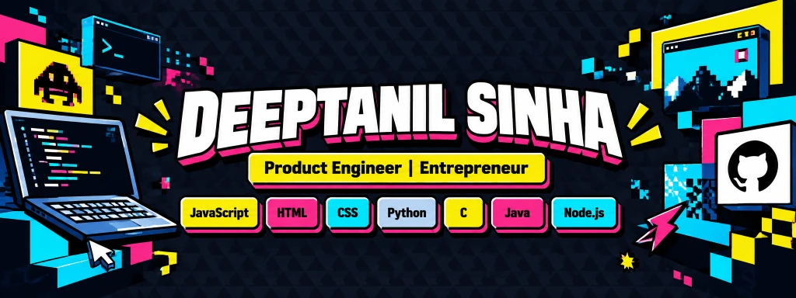
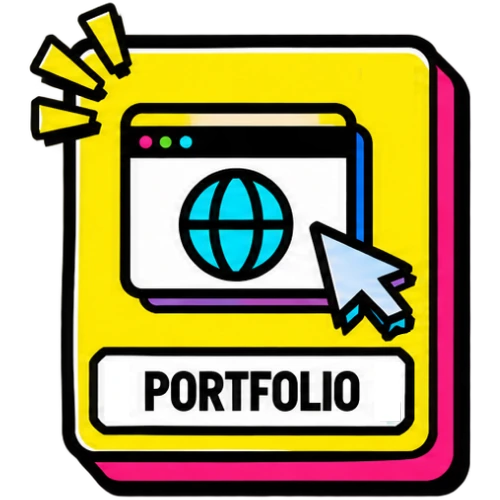
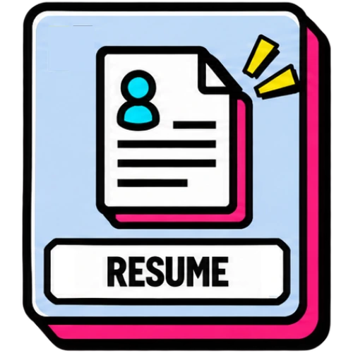

  <!-- ==================== MAIN HEADER BANNER (CLICKABLE TO PORTFOLIO) ==================== -->
  

    
  <!-- ==================== ABOUT ME ==================== -->
  
Hi, I'm Deeptanil. My journey started with taking apart toys as a kid, driven by curiosity about how things worked. That curiosity eventually led me to Arduino, experimenting with technology and finding new ways to bring ideas to life. Today, I've co-founded two brands, built digital products, and I'm constantly working on projects that genuinely interest me. I'm big on learning by building, figuring things out along the way, and pushing myself beyond what I already know. Right now, I'm focused on building my skills, creating things I'm proud of, and working towards something much bigger than where I am today. **This is just the beginning.**

  <!-- ==================== INFO & SOCIAL BUTTONS ==================== -->
  
  &nbsp;
  
  &nbsp;
  
  &nbsp;
  
  &nbsp;
  

