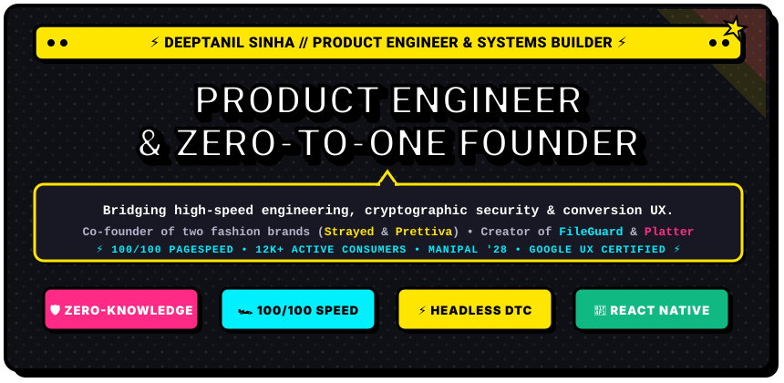
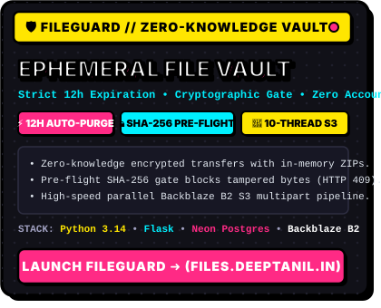
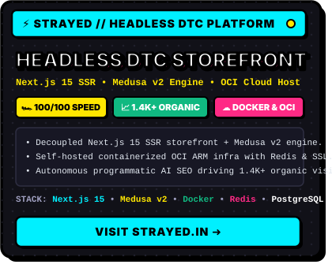
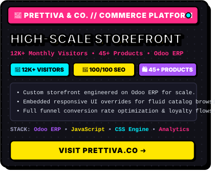
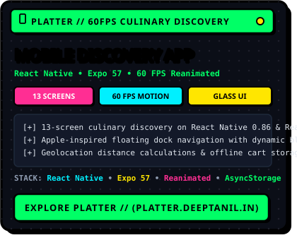
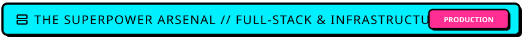
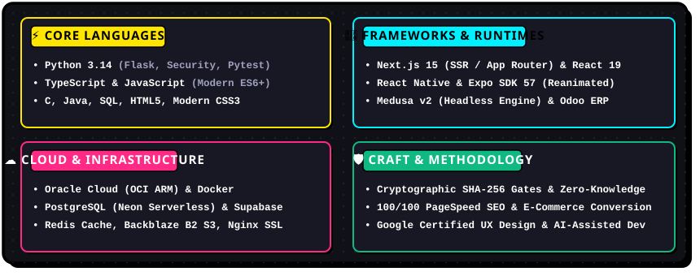
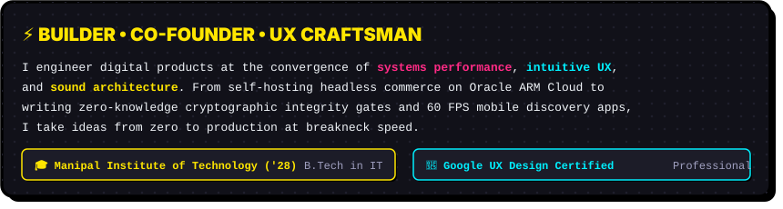

  <!-- ==================== HERO COMIC BANNER ==================== -->
  

    

  <!-- ==================== ACTION DISPATCH BUTTONS ==================== -->
  
  &nbsp;
  
  &nbsp;
  
  &nbsp;
  
  &nbsp;
  

    

---

<!-- ==================== FEATURED PRODUCTION DISPATCHES ==================== -->

  

 

<table width="100%" border="0" cellspacing="10" cellpadding="0">
  <tr>
    <td width="50%" align="center" valign="top">
      
    </td>
    <td width="50%" align="center" valign="top">
      
    </td>
  </tr>
  <tr>
    <td width="50%" align="center" valign="top">
      
    </td>
    <td width="50%" align="center" valign="top">
      
    </td>
  </tr>
</table>

 

---

<!-- ==================== TECH STACK & ARSENAL ==================== -->

  
  
    
  
  

    

  <!-- Comic Badge Row: Languages & Frameworks -->
  
  &nbsp;
  
  &nbsp;
  
  &nbsp;
  
  &nbsp;
  
  &nbsp;
  

    

  <!-- Comic Badge Row: Cloud & Infrastructure -->
  
  &nbsp;
  
  &nbsp;
  
  &nbsp;
  
  &nbsp;
  
  &nbsp;
  

 

---

<!-- ==================== ORIGIN STORY & ACADEMICS ==================== -->

  

    

  

 

---

<!-- ==================== RADAR INTELLIGENCE / GITHUB STATS ==================== -->

  

    

  <table width="100%" border="0" cellspacing="10" cellpadding="0">
    <tr>
      <td width="50%" align="center" valign="middle">
        
      </td>
      <td width="50%" align="center" valign="middle">
        
      </td>
    </tr>
  </table>

   

  

 

---

<!-- ==================== CONNECT / DISPATCH ==================== -->

  

    

  

    <b>Got an ambitious project, systems challenge, or zero-to-one venture?</b> 
    <i>Transmitting on all channels. Reach out anytime!</i>
  

  
  &nbsp;
  
  &nbsp;
  
  &nbsp;
  

    
  
  

    ⚡ Designed in Neo-Brutalist Comic Pop Style • Built &amp; Maintained by <b>Deeptanil Sinha</b> ⚡
  

